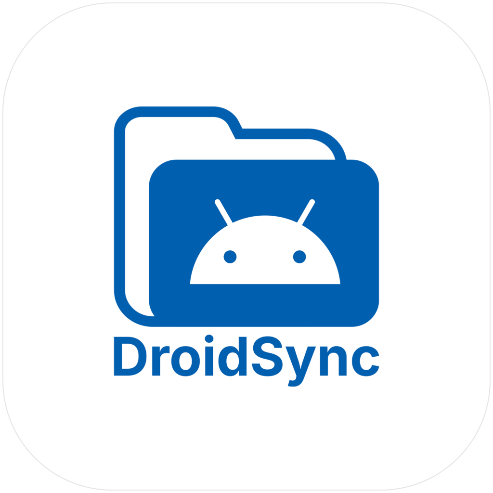

# DroidSync

<p align="center">
  
</p>

<p align="center">
  <strong>Native macOS Android Device Manager</strong><br />
  High-performance, featherweight, and beautiful macOS companion for Android devices.
</p>

<p align="center">
  <a href="https://github.com/kyawmoeoo2020/DroidSync/releases/latest"></a>
  <a href="LICENSE"></a>
  
  
  
</p>

---

**DroidSync** is a native macOS application engineered in **SwiftUI** and **Swift 6** to connect, control, and manage Android phones and tablets with zero friction. It completely replaces slow, clunky, and outdated alternatives like Android File Transfer, OpenMTP, and MacDroid with an ultra-responsive, lightweight experience designed specifically for Apple Silicon and Intel Macs.

**Author & Creator:** [Kyaw Moe Oo](https://github.com/kyawmoeoo2020)  
**Copyright:** © 2026 Kyaw Moe Oo. All rights reserved.

---

## 📥 Download & Installation

1. Download the latest **`DroidSync.dmg`** installer from the **[Releases Page](https://github.com/kyawmoeoo2020/DroidSync/releases/latest)**.
2. Open `DroidSync.dmg` and drag **DroidSync** into your **Applications** folder.
3. On your Android phone, enable **USB Debugging** in *Developer Options*, connect via USB or Wi-Fi, and launch DroidSync!

---

## ✨ Core Features

### 📱 Real-time Dashboard & Hardware Diagnostics
- **Live Battery Health**: Battery percentage, charging status, and live battery temperature gauge (°C).
- **Storage Overview**: Visual progress meter showing used vs. free internal storage.
- **Device Details**: Automatic detection of device model, manufacturer, Android OS version, and serial ID.
- **🖥️ 1-Click Screen Mirroring**: Mirror and control your phone live on your Mac with zero-latency 60fps display, full mouse interaction, and Mac keyboard typing (`scrcpy` integration).

### 📁 Finder-Grade File Browser (List & Grid Views)
- **Dual Layout Modes**: Switch between detailed **List View** and Finder-style **Grid View** with scalable icon previews.
- **✏️ In-Place File & Folder Renaming**: Rename files and folders directly with right-click ➔ **Rename...**.
- **🔍 Deep Device Search**: Search scope switcher to search the current directory or search everywhere across the entire phone storage recursively.
- **Two-way Drag & Drop**: Drag files and folders directly between macOS Finder and your Android storage.
- **👁 Quick Look (Spacebar Preview)**: Preview photos, audio, videos, and documents directly from the device without transferring them first.
- **Real-Time Transfer Progress**: Accurate progress bar displaying real-time transfer speed (MB/s), bytes transferred, percentage, and estimated time remaining (ETA).
- **Multi-Selection & Batch Actions**: Batch download, multi-file deletion, and folder creation.

### 🖼️ Dedicated Camera & Photos Media Gallery
- **Apple Photos-Style Gallery**: Visual photo grid organized by source: **Camera (DCIM)**, **Pictures**, **Screenshots**, and **Videos**.
- **Thumbnail Zoom Slider**: Dynamically resize photo thumbnails from compact to extra-large.
- **1-Click Import to Mac**: Select multiple photos and batch export them straight into your Mac's Pictures or custom folder.
- **Direct Quick Look**: Spacebar or double-click to view photos and videos in full resolution without downloading them first.

### 📸 Device Screenshots & Screen Recording
- **1-Click Screenshot Tool**: Captures full-resolution phone screenshots in sub-second time via native binary streaming (`exec-out screencap -p`).
- **Mac Preview & Copy**:
  - **Copy to Clipboard**: Instantly copy the captured screenshot to your macOS clipboard for `⌘V` paste into Slack, Figma, Telegram, Notes, or Mail.
  - **Save Image**: Save PNG directly to your Mac with automatic Finder reveal.
- **Screen Recording**: 1-click screen recording to MP4 with live recording timer. Gracefully preserves MP4 container index and automatically reveals video in Finder.

### 📦 App Manager & Batch APK Backup
- **Comprehensive App Manager**: Inspect all installed apps, filtered by User Apps (3rd-party), System Apps, All Apps, and Frozen/Disabled Apps.
- **Batch APK Backup**: Select multiple apps (or all apps) and export their `.apk` installers to Mac in a single click with progress bars.
- **Drag & Drop APK Installer**: Drag any `.apk` file into DroidSync to automatically install it with `-r -d -g` runtime permissions.
- **Device Controls**: Launch apps directly on the phone, force stop background apps, clear data/cache, or freeze/disable bloatware.

### ⚡ Power & Hardware Quick Controls
- **Reboot Menu**: 1-click shortcuts to **Normal Reboot**, **Recovery Mode**, and **Bootloader / Fastboot**.
- **Lock / Wake Screen**: Instant hardware power key toggle (`KEYCODE_POWER`).
- **Volume Adjustments**: Adjust phone volume up, down, or mute from your Mac.

### 📋 Mac ➔ Phone Clipboard Sharing
- **Push Text to Phone**: Automatically grabs current Mac clipboard or custom text and sends keystrokes directly into whatever input field is focused on Android.

### 🧹 Storage Lens (Disk Space Analyzer)
- **Folder Breakdown**: Interactive directory tree analyzing storage consumption folder by folder.
- **Large Space Wasters**: Scans the phone for files exceeding 25MB, 50MB, 100MB, or 500MB with 1-click Quick Look preview, download, and delete.

### 📶 Wireless ADB Pairing (Wi-Fi Mode)
- **Cable-Free Freedom**: Built-in wireless pairing assistant compatible with Android 11+ Wireless Debugging (pairing code + port).
- Reconnect to previously paired devices over local Wi-Fi with one click.

---

## 🛠 Tech Stack & Architecture

- **Language**: Swift 6 (Strict Concurrency `Sendable` compliant)
- **UI Framework**: SwiftUI + AppKit (macOS 14 Sonoma & macOS 15 Sequoia)
- **Build System**: Swift Package Manager (SPM)
- **Protocol**: Android Debug Bridge (ADB) via high-speed Unix pipes & PTY
- **Installer**: Custom DMG with background styling, volume icon, and Applications symlink

---

## 💻 Building from Source

### Prerequisites
- macOS 14.0 or later
- Xcode 15+ / Xcode Command Line Tools
- Android SDK Platform-Tools (`adb`)

### Clone & Build
```bash
# Clone the repository
git clone https://github.com/kyawmoeoo2020/DroidSync.git
cd DroidSync

# Build debug binary
swift build

# Run directly
swift run DroidSync

# Package release macOS App bundle
./bundle.sh

# Generate release macOS DMG installer
./build-dmg.sh
```

---

## 📄 License & Attribution

DroidSync is open-source software licensed under the **[Apache License, Version 2.0](LICENSE)**.

### Trademark & Name Notice
The project name **"DroidSync"** and developer name **"Kyaw Moe Oo"** are identity identifiers of the original author.
- Under Section 6 of the Apache License 2.0, this license does not grant permission to use the name or trademarks of the Licensor to endorse or promote derivative products.
- In accordance with Section 4(d) and the [NOTICE](NOTICE) file, original author attribution to **Kyaw Moe Oo** must be preserved in all copies, derivative works, documentation, and user-facing credits.

Copyright © 2026 **Kyaw Moe Oo**. All rights reserved.
